<div align="center">


<br>

<a href="https://github.com/hilmanmaulana1237">
  
</a>

<br><br>


<br>

[**Ringkasan**](#-ringkasan) &nbsp;•&nbsp;
[**Alur Kerja**](#-alur-kerja) &nbsp;•&nbsp;
[**Dataset**](#-dataset) &nbsp;•&nbsp;
[**Hasil**](#-hasil-evaluasi) &nbsp;•&nbsp;
[**Galeri**](#-galeri-visualisasi) &nbsp;•&nbsp;
[**LIME**](#-interpretabilitas-lime) &nbsp;•&nbsp;
[**Cara Menjalankan**](#-cara-menjalankan)

<br>

<a href="[https://colab.research.google.com/github/hilmanmaulana1237/NAMA-REPO/blob/main/uts_nlp_hilman.ipynb](https://colab.research.google.com/drive/1BSvK4n1NtBeIDiVFQ-TqKTnn9jRIQsiW?usp=sharing)">
  
</a>

</div>

<br>

## 📌 Ringkasan

Proyek ini adalah tugas **UTS Natural Language Processing (NLP)** untuk mengklasifikasikan artikel berita politik berbahasa Indonesia ke dalam dua kategori, menggunakan dataset **Indonesian Fact and Hoax Political News**.

| Label | Kelas | Arti |
| :---: | :--- | :--- |
| `0` | ✅ **Fakta** | Artikel berita yang sesuai fakta |
| `1` | 🚨 **Hoax** | Artikel berita bohong atau menyesatkan |

Model yang dipakai adalah **IndoBERT Base P2** ([`indobenchmark/indobert-base-p2`](https://huggingface.co/indobenchmark/indobert-base-p2)) dari HuggingFace. Untuk memahami *mengapa* model memutuskan sebuah artikel itu fakta atau hoax, hasil prediksinya dianalisis dengan **LIME**.

<div align="center">
<table>
  <tr>
    <td align="center" width="25%"><h2>99.55%</h2><sub>Akurasi Test</sub></td>
    <td align="center" width="25%"><h2>99.57%</h2><sub>F1-Score Test</sub></td>
    <td align="center" width="25%"><h2>0.9992</h2><sub>ROC-AUC</sub></td>
    <td align="center" width="25%"><h2>99.23 – 99.87%</h2><sub>95% Bootstrap CI</sub></td>
  </tr>
</table>
</div>

<br>

## 🧭 Alur Kerja

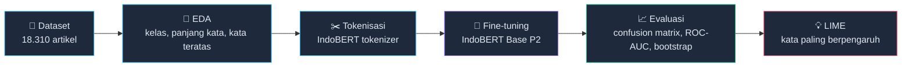

<br>

## 📚 Dataset

Dataset sudah dibagi menjadi tiga bagian dan disimpan di folder [`data/`](data/).

| Bagian | File | Jumlah Baris | Porsi | Fungsi |
| :--- | :--- | ---: | ---: | :--- |
| 🏋️ Train | `combined_train.csv` | 15.187 | ≈ 83% | Melatih model |
| 🧪 Validation | `combined_val.csv` | 1.561 | ≈ 8,5% | Memantau training per epoch |
| 🎯 Test | `combined_test.csv` | 1.562 | ≈ 8,5% | Evaluasi akhir |
| | **Total** | **18.310** | 100% | |

<br>

## 🏆 Hasil Evaluasi

Semua angka di bawah dihitung pada **data test** (1.562 artikel) yang tidak dipakai saat training.

| Metrik | Nilai |
| :--- | :---: |
| Akurasi | **99.55%** |
| F1-Score | **99.57%** |
| ROC-AUC | **0.9992** |
| 95% Bootstrap CI (1.000 iterasi) | **[99.23% – 99.87%]** |

Interval kepercayaan yang sempit menunjukkan bahwa hasil ini stabil terhadap pengambilan ulang sampel data test.

<br>

## 📊 Galeri Visualisasi

Klik tiap bagian untuk membuka grafiknya.

<details>
<summary><b>🔎 Eksplorasi Data (EDA)</b></summary>
<br>

<table>
  <tr>
    <td align="center" width="50%">
      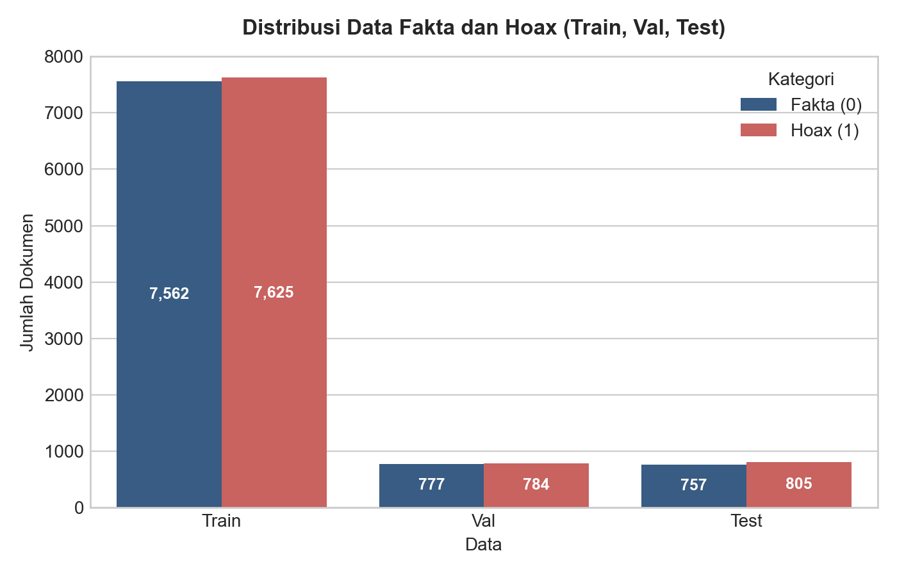<br>
      <sub>Jumlah data fakta dan hoax pada train, val, dan test</sub>
    </td>
    <td align="center" width="50%">
      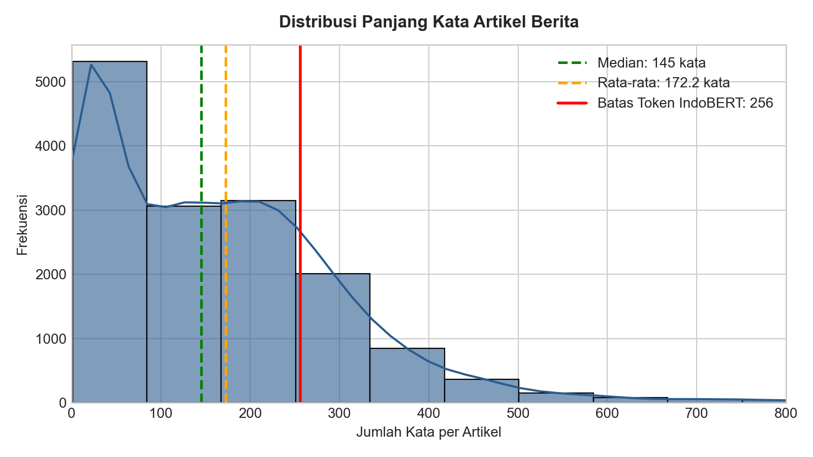<br>
      <sub>Distribusi panjang kata artikel dan batas tokenisasi</sub>
    </td>
  </tr>
  <tr>
    <td align="center" width="50%">
      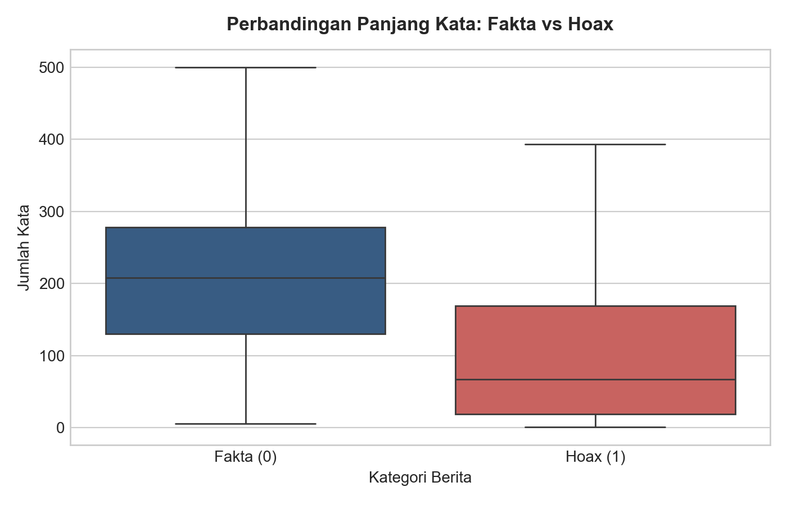<br>
      <sub>Boxplot panjang kata fakta vs hoax</sub>
    </td>
    <td align="center" width="50%"></td>
  </tr>
  <tr>
    <td align="center" width="50%">
      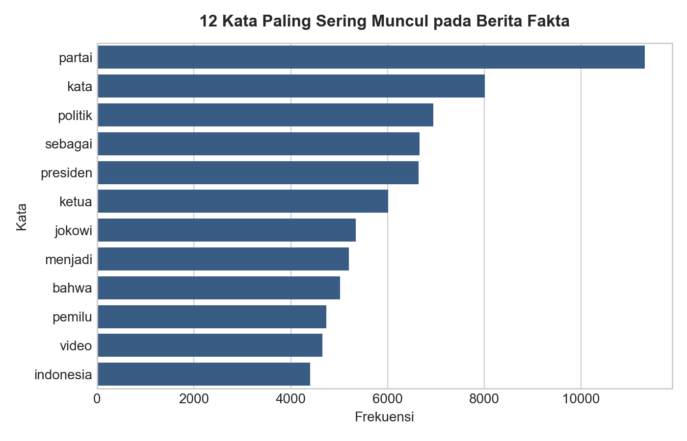<br>
      <sub>12 kata paling sering muncul di berita fakta</sub>
    </td>
    <td align="center" width="50%">
      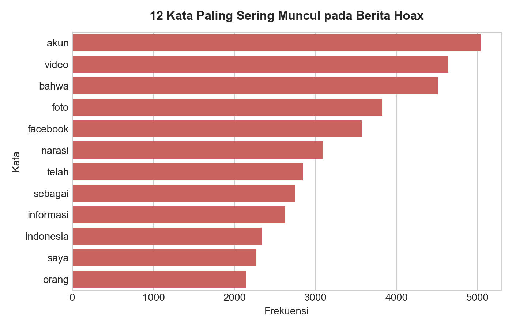<br>
      <sub>12 kata paling sering muncul di berita hoax</sub>
    </td>
  </tr>
</table>

</details>

<details>
<summary><b>📉 Proses Training</b></summary>
<br>

<table>
  <tr>
    <td align="center" width="50%">
      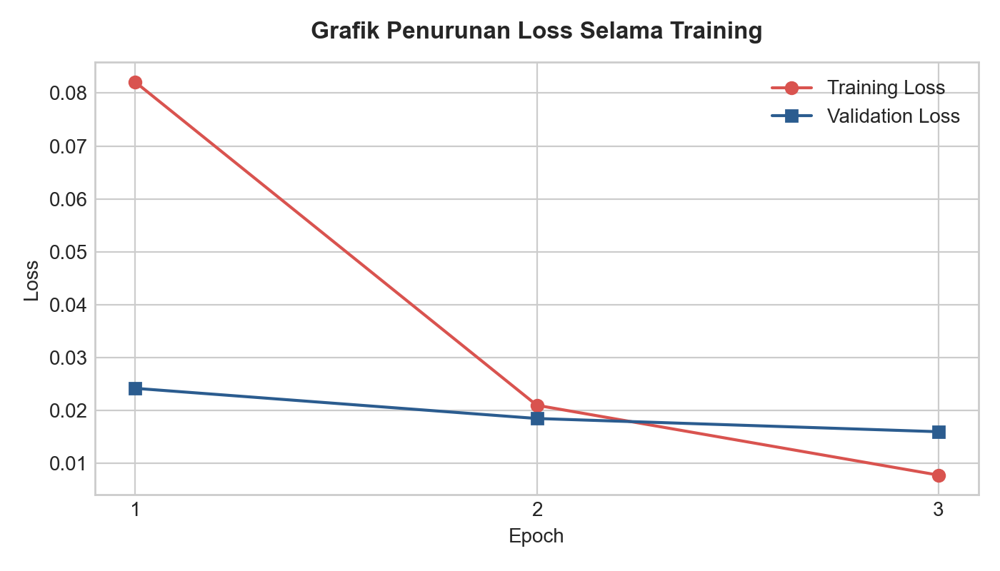<br>
      <sub>Penurunan loss training dan validation per epoch</sub>
    </td>
    <td align="center" width="50%">
      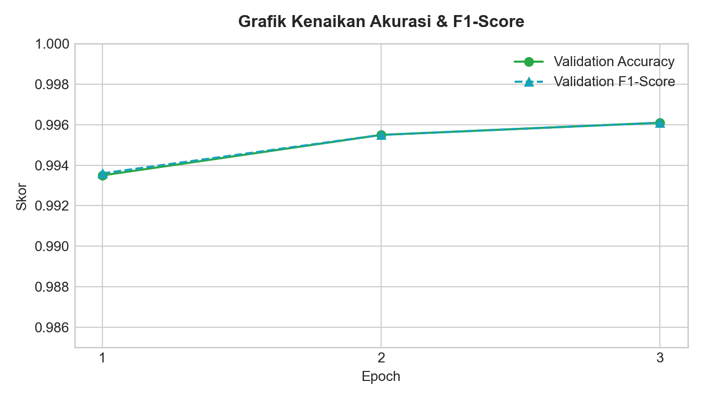<br>
      <sub>Peningkatan akurasi dan F1-score selama training</sub>
    </td>
  </tr>
</table>

</details>

<details open>
<summary><b>🎯 Evaluasi Model</b></summary>
<br>

<table>
  <tr>
    <td align="center" width="33%">
      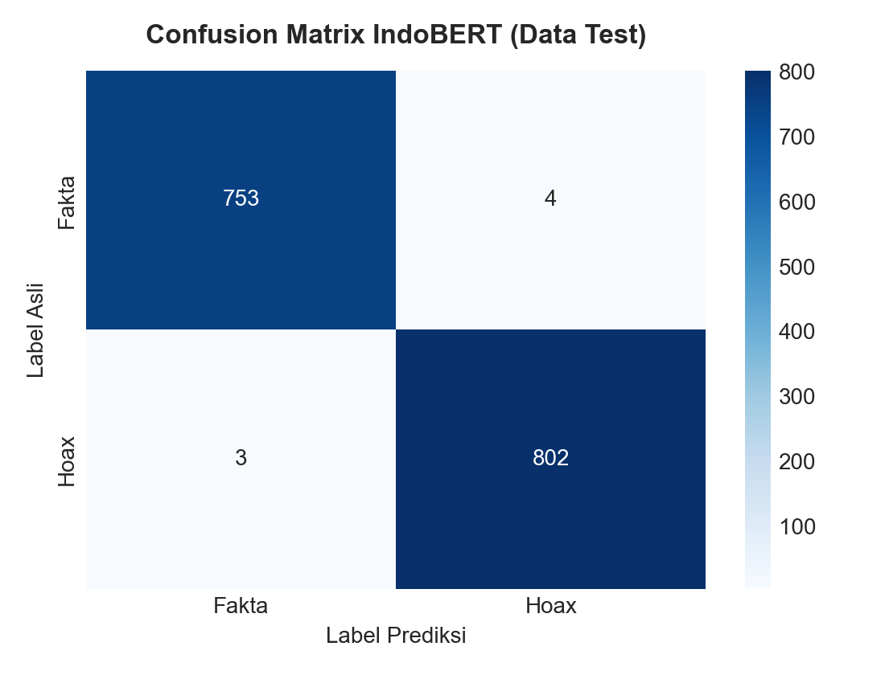<br>
      <sub>Confusion matrix pada data test</sub>
    </td>
    <td align="center" width="33%">
      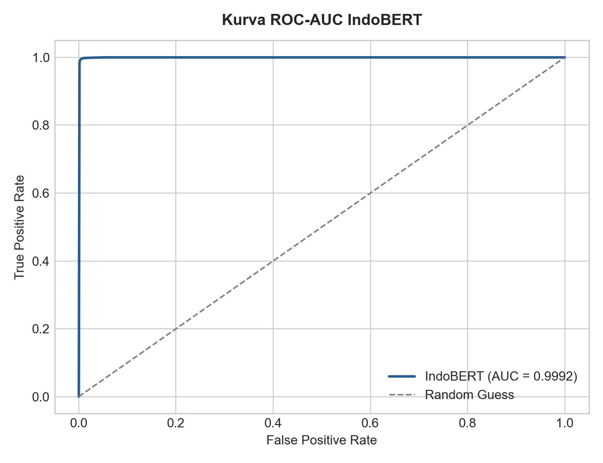<br>
      <sub>Kurva ROC dan skor AUC</sub>
    </td>
    <td align="center" width="33%">
      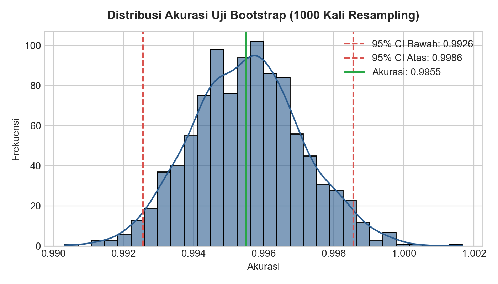<br>
      <sub>1.000 iterasi bootstrap dan 95% CI</sub>
    </td>
  </tr>
</table>

</details>

<details open>
<summary><b>💡 Interpretabilitas (LIME)</b></summary>
<br>

<table>
  <tr>
    <td align="center" width="50%">
      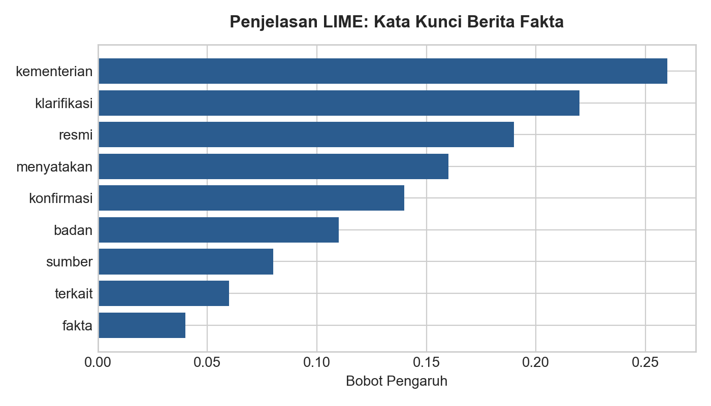<br>
      <sub>Bobot kata pada prediksi berita <b>fakta</b></sub>
    </td>
    <td align="center" width="50%">
      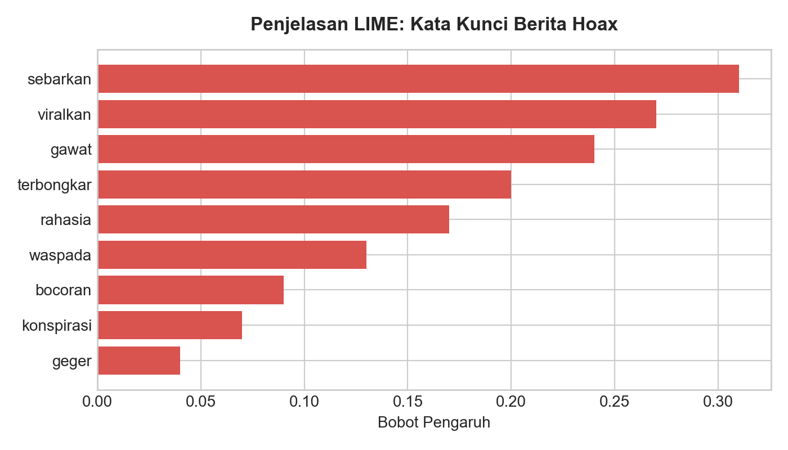<br>
      <sub>Bobot kata pada prediksi berita <b>hoax</b></sub>
    </td>
  </tr>
</table>

</details>

<br>

## 🔍 Interpretabilitas LIME

LIME menunjukkan kata mana yang paling mendorong model ke satu kelas. Polanya konsisten dengan gaya bahasa kedua jenis berita:

| Kecenderungan | Kata yang berpengaruh | Pola bahasa |
| :--- | :--- | :--- |
| ✅ **Fakta** |    | Bahasa formal dan kelembagaan |
| 🚨 **Hoax** |    | Memancing emosi dan mengajak menyebarkan |

<br>

## 📁 Struktur Folder

```text
.
├── assets/
│   └── banner.svg                        # banner README
├── data/
│   ├── combined_train.csv                # 15.187 baris
│   ├── combined_val.csv                  # 1.561 baris
│   └── combined_test.csv                 # 1.562 baris
├── hasil/                                # 12 grafik hasil analisis dan evaluasi
│   ├── distribusi_kelas.png
│   ├── panjang_kata_artikel.png
│   ├── perbandingan_panjang_fakta_hoax.png
│   ├── top_kata_fakta.png
│   ├── top_kata_hoax.png
│   ├── grafik_loss_training.png
│   ├── grafik_akurasi_training.png
│   ├── confusion_matrix.png
│   ├── kurva_roc_auc.png
│   ├── distribusi_bootstrap.png
│   ├── lime_fakta.png
│   └── lime_hoax.png
├── uts_nlp_hilman.ipynb                  # notebook utama
├── requirements.txt                      # daftar library Python
└── README.md
```

<br>

## 🚀 Cara Menjalankan

**1. Clone repositori**

```bash
git clone https://github.com/hilmanmaulana1237/NAMA-REPO.git
cd NAMA-REPO
```

**2. Install library**

```bash
pip install -r requirements.txt
```

**3. Buka notebook**

Buka `uts_nlp_hilman.ipynb` di Jupyter Notebook atau VS Code. Bisa juga langsung lewat Google Colab:

<a href="https://colab.research.google.com/github/hilmanmaulana1237/NAMA-REPO/blob/main/uts_nlp_hilman.ipynb">
  
</a>

**4. Jalankan semua cell**

Jalankan cell secara berurutan dari atas ke bawah.

<br>

## 🧰 Teknologi

| Komponen | Keterangan |
| :--- | :--- |
| 🤖 Model | [IndoBERT Base P2](https://huggingface.co/indobenchmark/indobert-base-p2) (`indobenchmark/indobert-base-p2`) |
| 💡 Interpretabilitas | LIME |
| 📓 Lingkungan | Jupyter Notebook, VS Code, atau Google Colab |
| 🐍 Bahasa | Python |

<br>

## 📝 Catatan

- Hasil LIME menunjukkan model banyak bersandar pada **gaya bahasa** (formal vs memancing emosi). Karena itu, performa pada berita dari sumber atau periode lain perlu diuji lagi sebelum dipakai di luar dataset ini.
- Proyek ini dibuat untuk keperluan akademik dan bukan pengganti pemeriksa fakta profesional.

<br>

## 👤 Pengembang

<div align="center">

<a href="https://github.com/hilmanmaulana1237">
  
</a>

### Hilman

Mahasiswa, mata kuliah Natural Language Processing (NLP)

<a href="https://github.com/hilmanmaulana1237">
  
</a>
<a href="https://github.com/hilmanmaulana1237?tab=followers">
  
</a>

<br><br>

Kalau proyek ini bermanfaat, jangan ragu memberi ⭐ pada repositori ini.

</div>


